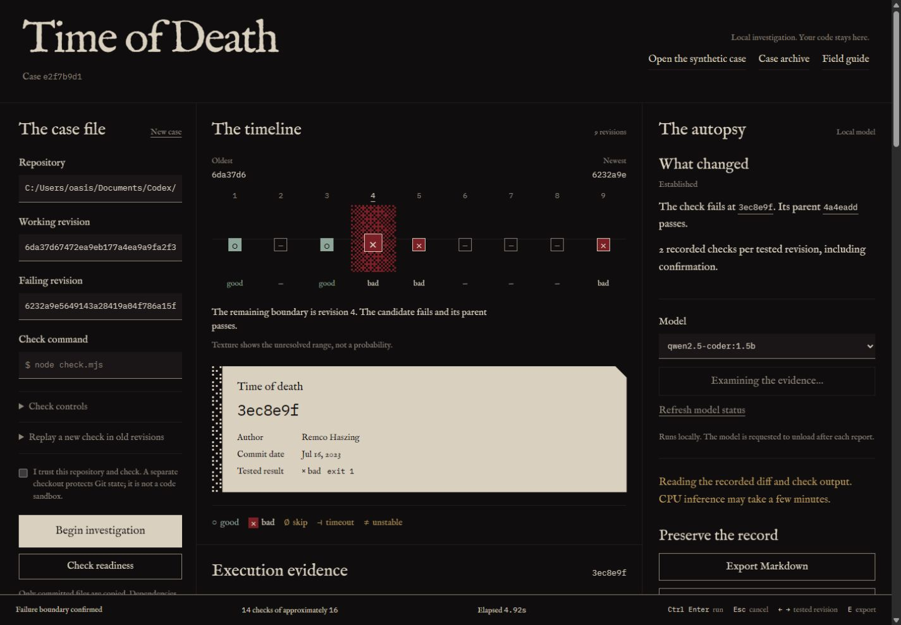
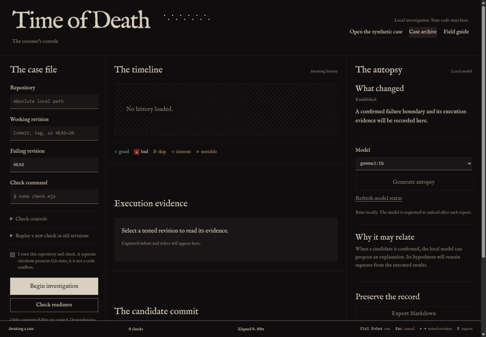
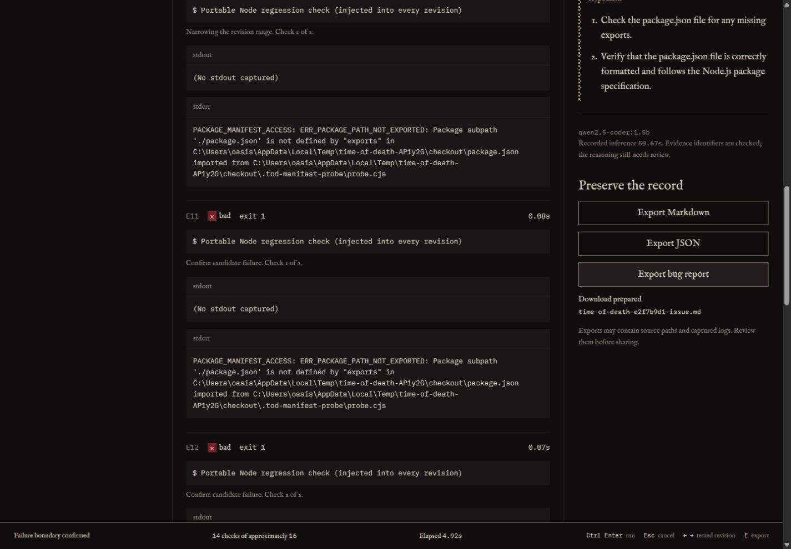
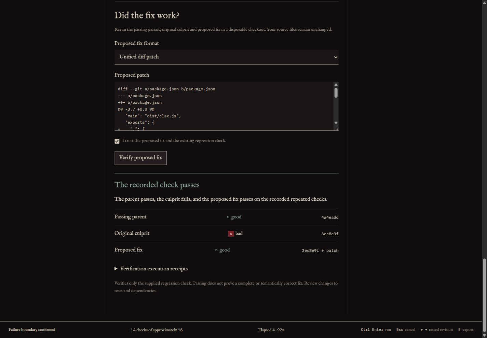

# Time of Death

**Find where your check started failing. Keep the evidence.**

A check that used to pass now fails. Somewhere in your Git history, a change crossed that boundary. Before you can fix the behavior, you need to know which change made the difference.

Time of Death is a local regression investigator: give it a working revision, a failing revision and a repeatable check. It searches the history, records what ran, and confirms a failing commit alongside its passing parent. An optional local model offers an explanation with references to that evidence.

[Download the prebuilt preview](https://github.com/abdulbsds25seecs-cloud/time-of-death/releases/tag/v0.1.0-preview.20261031) / [Run from source](#try-it-locally) / [Usage reference](docs/USAGE.md)

> **Preview status:** fix verification has an unresolved imported-helper integrity bug. A proposal can weaken a helper used by the check and receive a passing verdict. [Read the current limits](#what-still-needs-work) before relying on that feature.



The console confirms a failing candidate beside its passing parent. This capture shows an earlier interface; the current preview adds the compact workspace, flowing background and guided tour. Screenshots and the metrics below come from separate recorded runs.

## One import, one historical boundary

This is the check in the recorded public-history example:

```js
require.resolve('clsx/package.json');
```

It resolves against the older manifest. After an exports map is introduced, Node returns `ERR_PACKAGE_PATH_NOT_EXPORTED`: that package subpath is no longer exposed. The library's class-name function is not involved in this check.

Time of Death searched the selected history and identified the commit that changed the result:

The [saved execution record](evidence/real-world-case.json) identifies candidate `3ec8e9f` and passing parent `4a4eadd`. Untested revisions remain labeled separately; the app does not invent execution results for them.

The example reconstructs downstream package-manifest resolution using real public history and a minimal package layout. It does not install or build clsx. The [upstream exports-map change](https://github.com/lukeed/clsx/commit/3ec8e9fa2f6eef3911cb47f656ab761fc1030812) was intentional and marked breaking; this is not a newly discovered upstream defect.

In the saved Windows run, with two executions per selected revision:

| Observation | Recorded result |
| --- | --- |
| Selected history | 9 commits |
| Investigation | 14 check executions across 5 distinct revisions |
| Failing boundary / passing parent | `3ec8e9f` / `4a4eadd` |
| Investigation elapsed | 4.212 seconds, excluding AI inference |
| Demonstration compatibility patch | 6 executions: parent good, culprit bad, proposal good |

The timing describes this small manifest-resolution experiment, not arbitrary application builds. The patch passes this check; it does not establish a complete fix or recommend an upstream change. Inspect the [full report](evidence/real-world-case.md), [portable check](examples/clsx-package-exports-check.mjs) and [reproduction script](scripts/real-world-demo.mjs).

## See the app at work

These app captures predate the latest visual refresh. Each shows a specific operation and its visible result.

### Start with a check you can repeat



The case file asks for the repository, two revisions and a command. The empty timeline has no candidate: a verdict appears only after execution.

### Read the failure and preserve its receipt



The log contains the actual package-path error and confirmation runs. The export panel shows a prepared bug-report draft. A download does not post an issue.

### Compare a proposed patch with the original failure



This portable manifest-resolution example records parent good, culprit bad and proposal good. It establishes the result of this check; the unresolved imported-helper bug still limits general fix-verification trust.

## Try it locally

The **prebuilt preview** needs Node.js **22.13+** and Git. Extract the entire [release ZIP](https://github.com/abdulbsds25seecs-cloud/time-of-death/releases/download/v0.1.0-preview.20261031/time-of-death-prebuilt.zip), then open `Start-Time-of-Death.cmd` on Windows. On other platforms, run `node server.mjs` from the extracted folder.

Open `http://127.0.0.1:4317`, keep the server running, and choose **Open the synthetic case**, then **Begin investigation**. This creates a real Git repository with a deliberately introduced session-expiration regression. It is labeled synthetic throughout the app.

The first-visit **Take tour** walks through the console with section spotlights. **Do not show again** remembers your preference; the header can reopen the tour. **Typography** offers three locally bundled display fonts.

To build from source:

```powershell
git clone https://github.com/abdulbsds25seecs-cloud/time-of-death.git
cd time-of-death
npm ci
npm run build
npm start
```

The repository is currently private, so access is required to clone or download it. Running the standard local tool needs no cloud account, Docker or paid API. The prebuilt edition already includes its frontend and does not need `npm ci` for standard mode.

For a terminal-only synthetic demonstration:

```powershell
node cli.mjs --demo --output report.md
```

That writes a Markdown case file. To reproduce the historical example after installing source dependencies, run `npm run demo:real`; its first run downloads public Git history.

## What happens during a case

1. **Establish the check.** Select a trusted local repository and a linear good-to-bad range. Check readiness runs the endpoints first. A portable Node script can replay a newly written check in older revisions.
2. **Follow the search.** Git bisect narrows the range. Select a tested revision to inspect its command, exit code, duration, stdout and stderr. The dithered texture represents the unresolved interval, not a probability.
3. **Inspect and preserve.** Read the candidate diff, compare its failure with its passing parent, and export Markdown, JSON or a bug-report draft. Proposed-fix verification is available with the integrity limitation stated above. Nothing is posted automatically.

The source working tree is not switched, stashed or cleaned. Execution happens in a disposable clone of committed files. Historical dependencies are not installed automatically. The clone runs code with your account's permissions, so use repositories and commands you trust.

## Why the model runs locally

The autopsy receives a bounded diff and confirmation logs, then proposes explanations and next checks with evidence references. The model can be changed without replacing the Git investigation or its reports. With the default local configuration, those inputs stay on your machine.

Install Ollama separately and download a local model, for example:

```powershell
ollama pull gemma3:1b
```

The Git result and exports remain usable without a model. Small models have misread changes in [recorded attempts](evidence/ai-first-attempt.json), even with valid citation IDs. Model prose stays labeled as a hypothesis. A custom remote Ollama endpoint sends evidence to that configured machine.

Git supplies the search algorithm. Time of Death adds check replay, repeated outcomes, endpoint diagnosis, execution receipts and the visual workflow. Inspectable source and replaceable local models make those pieces adaptable. Model terms remain separate from the project's license.

## What the evidence establishes

These are separate recorded experiments, with different scopes:

| Experiment | Recorded outcome | Practical limit |
| --- | --- | --- |
| [Five synthetic histories](evidence/evaluation.json) | Three expected boundaries and two expected inconclusive cases | Dependency-free Windows desktop fixtures; two checks per selected revision; AI excluded |
| [Mastra autopsy](evidence/mastra-local-autopsy.json) | Evidence collection, local inference and citation validation | Valid references do not prove a correct interpretation |
| [Temporal worker restart](evidence/temporal-recovery.json) | Three completed checkpoints reused after a forced stop | Same local repository and checkpoint disk; an interrupted check can repeat |
| [Sentry setup](evidence/SENTRY_LIVE_VERIFICATION.md) | Controlled synthetic spans appeared in the live dashboard | Separate from a full real-model investigation trace; tracing is opt-in |
| [Copilot retest](evidence/COPILOT_RETEST_REPORT.md) | 42 tests passed and one helper reproducer failed in that run | Later UI changes have focused checks, not a new full acceptance claim |

These records show the conditions under which each result was observed. They do not establish arbitrary-repository reliability or T480 performance. [Integration setup](INTEGRATIONS.md) covers the optional SDKs and services; standard mode does not load those SDKs.

## What still needs work

**The current blocker is imported check code.** A proposed patch can leave `check.mjs` unchanged, weaken a helper it imports, and receive `passed`. Copilot's [unchanged reproducer](test/copilot-retest.test.mjs) still fails. A passing fix-verification receipt does not establish that the original check's integrity was preserved.

- The selected history must be linear and at most 500 revisions. A bug that disappears and returns can violate the good-to-bad assumption.
- Timeouts, unstable repeats and untestable revisions can prevent a conclusive result. Missing-module detection is a limited heuristic; target failure text gives the check more specificity.
- A disposable checkout is not a code sandbox. Exports may contain paths, logs and the portable script; review them before sharing.
- Local AI can give a wrong explanation. Evidence references are checked, but reasoning still needs review.
- The latest tour, focus behavior and animation need real-browser acceptance testing. T480 performance has not been measured.

Run the source tests with `npm test`. The suite includes the preserved failing helper reproducer. GitHub Actions is disabled for this private preview; no green hosted CI result is implied. [CURRENT_BUILD.md](CURRENT_BUILD.md) describes the uploaded snapshot.

## Source, credits and next steps

The project source is [MIT licensed](LICENSE). Git, Node.js, Ollama, models and dependencies retain their own licenses and terms. Font notices and the clsx license are included in [licenses/](licenses/).

Codex helped build the tool. Copilot challenged it with independent reports and executable reproducers; the findings, fixes and outstanding failure remain in [evidence/](evidence/). The coroner metaphor follows an old change still affecting today's program: establish when the check changed, then investigate why.

Start with the [synthetic case in the prebuilt preview](https://github.com/abdulbsds25seecs-cloud/time-of-death/releases/tag/v0.1.0-preview.20261031). For your own project, pick one repeatable failure and two revisions you can defend. The [usage reference](docs/USAGE.md) covers commands, exit codes, portable scripts, recovery, privacy and optional integrations.
