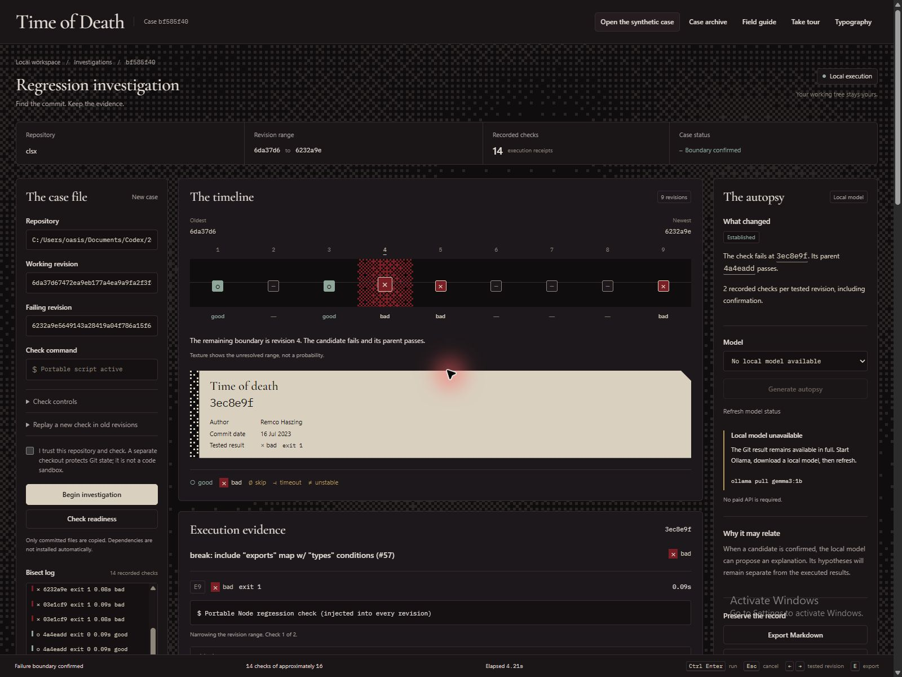
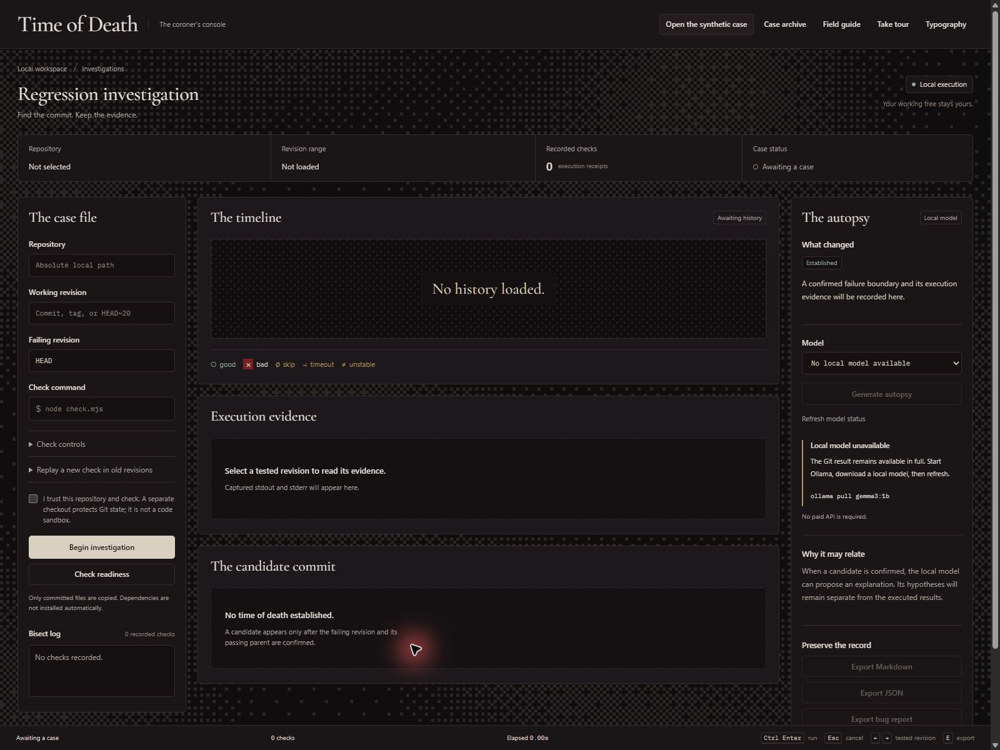
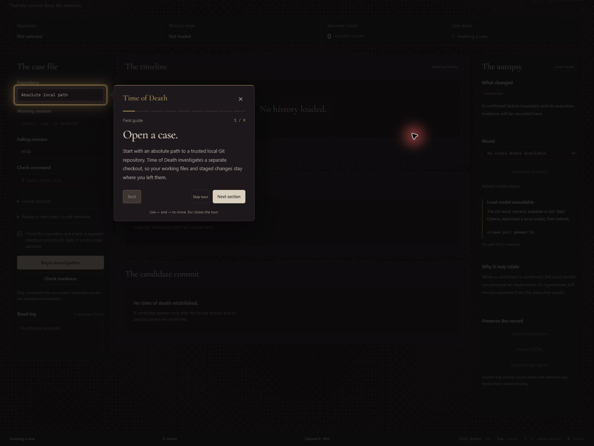
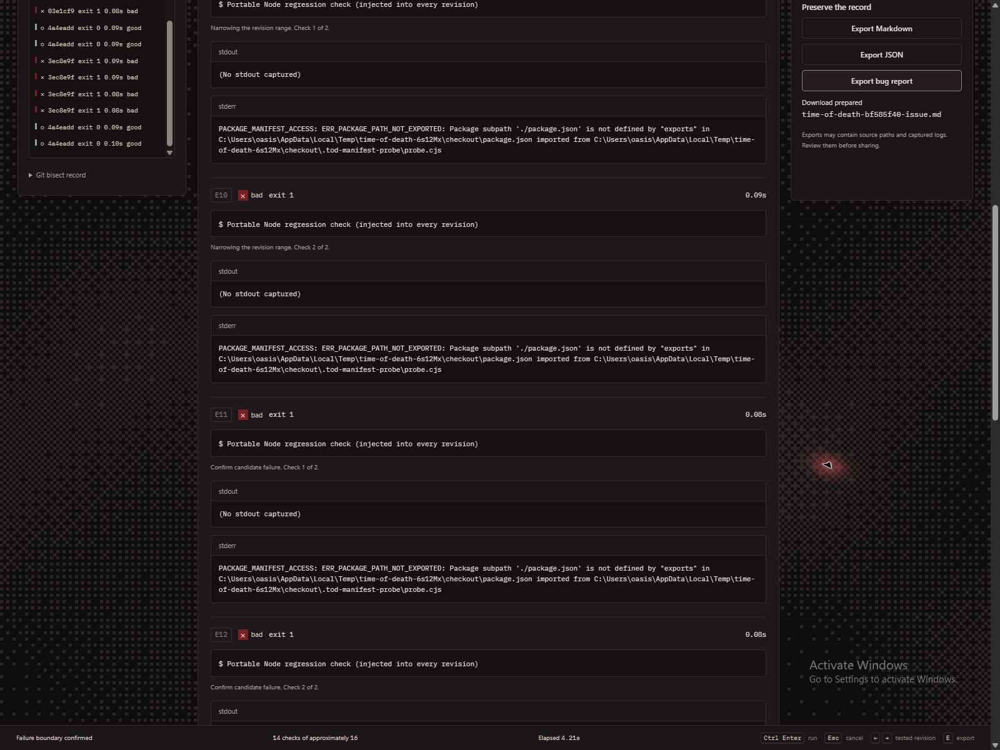
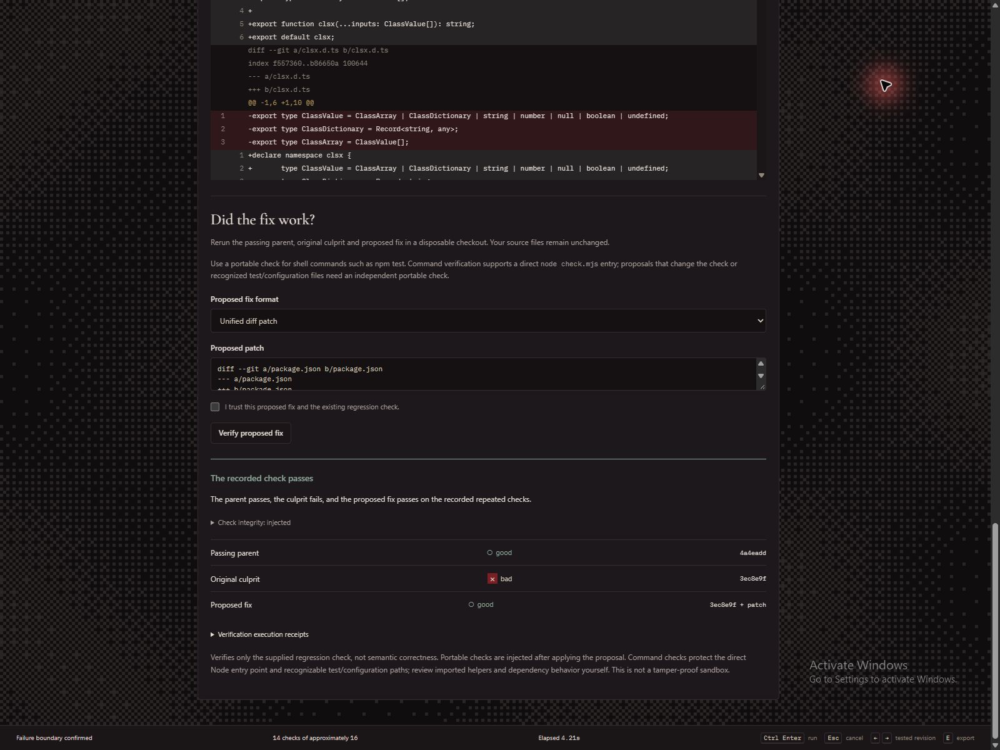

# Time of Death

**Find where your check started failing. Keep the evidence.**

A check that used to pass now fails. Somewhere in your Git history, a change crossed that boundary. Before you can fix the behavior, you need to know which change made the difference.

Time of Death is a local regression investigator: give it a working revision, a failing revision and a repeatable check. It searches the history, records what ran, and confirms a failing commit alongside its passing parent. An optional local model offers an explanation with references to that evidence.

[Explore the live recorded demo](https://abdulbsds25seecs-cloud.github.io/time-of-death/) / [Download the prebuilt preview](https://github.com/abdulbsds25seecs-cloud/time-of-death/releases/tag/v0.2.0-preview.20261031) / [Run from source](#try-it-locally) / [Usage reference](docs/USAGE.md)

> **Fresh acceptance:** 57 local tests passed, including Copilot's unchanged helper reproducer and its final independent API test. Command fix replay now restricts proposals to the original culprit change set. [Acceptance and limits](evidence/FINAL_ACCEPTANCE.md) / [Live demo verification](evidence/pages-live-verification.json).



The current console displays a saved historical investigation: candidate `3ec8e9f` fails the check, while parent `4a4eadd` passes. The fourteen execution receipts and elapsed time belong to that saved run. [View all seven current-interface screenshots](docs/SCREENSHOTS.md).

## One import, one historical boundary

This is the check in the recorded public-history example:

```js
require.resolve('clsx/package.json');
```

It resolves against the older manifest. After an exports map is introduced, Node returns `ERR_PACKAGE_PATH_NOT_EXPORTED`: that package subpath is no longer exposed. The library's class-name function is not involved in this check.

Time of Death searched the selected history and identified the commit that changed the result:

The [saved execution record](evidence/real-world-case.json) identifies candidate `3ec8e9f` and passing parent `4a4eadd`. Untested revisions remain labeled separately; the app does not invent execution results for them.

The example reconstructs downstream package-manifest resolution using real public history and a minimal package layout. It does not install or build clsx. The [upstream exports-map change](https://github.com/lukeed/clsx/commit/3ec8e9fa2f6eef3911cb47f656ab761fc1030812) was intentional and marked breaking; this is not a newly discovered upstream defect.

In the latest Windows run, with two executions per selected revision (screenshots show an earlier run of the same case):

| Observation | Recorded result |
| --- | --- |
| Selected history | 9 commits |
| Investigation | 14 check executions across 5 distinct revisions |
| Failing boundary / passing parent | `3ec8e9f` / `4a4eadd` |
| Investigation elapsed | 4.630 seconds, excluding AI inference |
| Demonstration compatibility patch | 6 executions: parent good, culprit bad, proposal good |

The timing describes this small manifest-resolution experiment, not arbitrary application builds. The patch passes this check; it does not establish a complete fix or recommend an upstream change. Inspect the [full report](evidence/real-world-case.md), [portable check](examples/clsx-package-exports-check.mjs) and [reproduction script](scripts/real-world-demo.mjs).

## See the app at work

Fresh desktop captures show the current workspace and real saved results. The case was reopened from the archive, and the bug-report download was exercised through the UI.

### Start with a check you can repeat



The case file asks for the repository, two revisions and a command. The empty timeline has no candidate: a verdict appears only after execution.

### Follow the spotlight tour



The tour explains one section at a time while dimming the surrounding page. This capture shows step 1 of 9, reopened from the header.

### Read the failure and preserve its receipt



The log contains the actual package-path error and confirmation runs. The export panel shows a prepared bug-report draft. A download does not post an issue.

### Compare a proposed patch with the original failure



This portable manifest-resolution example records parent good, culprit bad and proposal good. It establishes the result of this check; portable checks must keep their assertion logic independent of modified application code.

## Explore online or run locally

The [live GitHub Pages demo](https://abdulbsds25seecs-cloud.github.io/time-of-death/) is a static interactive case explorer. It replays saved results from the public clsx experiment, with selectable revisions, receipts, diffs, patch checks, the reviewed AI response and report downloads. It runs independently of the author's computer. It does not execute Git, call a model or access visitors' files.

## Try it locally

The **prebuilt preview** needs Node.js **22.13+** and Git. Extract the entire [release ZIP](https://github.com/abdulbsds25seecs-cloud/time-of-death/releases/download/v0.2.0-preview.20261031/time-of-death-prebuilt.zip), then open `Start-Time-of-Death.cmd` on Windows. On other platforms, run `node server.mjs` from the extracted folder.

Open `http://127.0.0.1:4317`, keep the server running, and choose **Open the synthetic case**, then **Begin investigation**. This creates a real Git repository with a deliberately introduced session-expiration regression. It is labeled synthetic throughout the app.

The first-visit **Take tour** walks through the console with section spotlights. **Do not show again** remembers your preference; the header can reopen the tour. **Typography** offers three locally bundled display fonts.

To build from source:

```powershell
git clone https://github.com/abdulbsds25seecs-cloud/time-of-death.git
cd time-of-death
npm ci
npm run build
npm start
```

The repository and preview download are public. Running the standard local tool needs no cloud account, Docker or paid API. The prebuilt edition already includes its frontend and does not need `npm ci` for standard mode.

For a terminal-only synthetic demonstration:

```powershell
node cli.mjs --demo --output report.md
```

That writes a Markdown case file. To reproduce the historical example after installing source dependencies, run `npm run demo:real`; its first run downloads public Git history.

## What happens during a case

1. **Establish the check.** Select a trusted local repository and a linear good-to-bad range. Check readiness runs the endpoints first. A portable Node script can replay a newly written check in older revisions.
2. **Follow the search.** Git bisect narrows the range. Select a tested revision to inspect its command, exit code, duration, stdout and stderr. The dithered texture represents the unresolved interval, not a probability.
3. **Inspect and preserve.** Read the candidate diff, compare its failure with its passing parent, and export Markdown, JSON or a bug-report draft. Command fix replay is restricted to the original culprit change set; broader proposals require an independent portable check. Nothing is posted automatically.

The source working tree is not switched, stashed or cleaned. Execution happens in a disposable clone of committed files. Historical dependencies are not installed automatically. The clone runs code with your account's permissions, so use repositories and commands you trust.

## Why the model runs locally

The autopsy receives a bounded diff and confirmation logs, then proposes explanations and next checks with evidence references. The model can be changed without replacing the Git investigation or its reports. With the default local configuration, those inputs stay on your machine.

Install Ollama separately and download a local model, for example:

```powershell
ollama pull gemma3:1b
```

The Git result and exports remain usable without a model. Small models have misread changes in [recorded attempts](evidence/ai-first-attempt.json), even with valid citation IDs. Model prose stays labeled as a hypothesis. A custom remote Ollama endpoint sends evidence to that configured machine.

Git supplies the search algorithm. Time of Death adds check replay, repeated outcomes, endpoint diagnosis, execution receipts and the visual workflow. Inspectable source and replaceable local models make those pieces adaptable. Model terms remain separate from the project's license.

## What the evidence establishes

These are separate recorded experiments, with different scopes:

| Experiment | Recorded outcome | Practical limit |
| --- | --- | --- |
| [Five synthetic histories](evidence/evaluation.json) | Three expected boundaries and two expected inconclusive cases | Dependency-free Windows desktop fixtures; two checks per selected revision; AI excluded |
| [Fresh Mastra autopsy](evidence/final-partner-run.json) | Three steps; local Qwen produced 301 tokens in 53.077 seconds | The explanation contains a chronology error; valid citations do not prove interpretation |
| [Temporal worker restart](evidence/temporal-recovery.json) | Three completed checkpoints reused after a fresh forced stop | Same local repository and checkpoint disk; an interrupted check can repeat |
| [Live Sentry transport](evidence/final-partner-run.json) | HTTP 200 acknowledged a real transaction with 14 child spans | New trace has not been visually verified in the dashboard; tracing is opt-in |
| [Fresh acceptance](evidence/FINAL_ACCEPTANCE.md) | 51 local tests passed; unchanged Copilot helper reproducer passes | Local checks, not hosted CI or arbitrary-repository certification |

These records show the conditions under which each result was observed. They do not establish arbitrary-repository reliability or T480 performance. [Integration setup](INTEGRATIONS.md) covers the optional SDKs and services; standard mode does not load those SDKs.

## What still needs work

**Fix replay has a deliberately restricted scope.** Command proposals cannot change the entry check, recognized test/configuration files, or files outside the original culprit change set. This blocks Copilot's imported-helper reproducer; its assertion remains unchanged. Accepted command replays carry `restricted` integrity rather than claiming a proven immutable dependency graph. Review check logic inside allowed original files. For broader proposals, use a portable check with independent assertions.

- The selected history must be linear and at most 500 revisions. A bug that disappears and returns can violate the good-to-bad assumption.
- Timeouts, unstable repeats and untestable revisions can prevent a conclusive result. Missing-module detection is a limited heuristic; target failure text gives the check more specificity.
- A disposable checkout is not a code sandbox. Exports may contain paths, logs and the portable script; review them before sharing.
- Local AI can give a wrong explanation. Evidence references are checked, but reasoning still needs review.
- Earlier desktop captures exercised tour opening, the first spotlight, archive loading, typography and report download. Fresh React DOM checks cover all nine steps, keyboard/focus, preferences and blocked storage; the HTTP journey covers investigation through restart. Complete visual browser/mobile acceptance remains pending. T480 performance has not been measured.

Run the source tests with `npm test`. The suite includes the preserved helper reproducer, which now passes. GitHub Actions is disabled for this preview; no green hosted CI result is implied. [CURRENT_BUILD.md](CURRENT_BUILD.md) describes the uploaded snapshot.

## Source, credits and next steps

The project source is [MIT licensed](LICENSE). Git, Node.js, Ollama, models and dependencies retain their own licenses and terms. Font notices and the clsx license are included in [licenses/](licenses/).

Codex helped build the tool. Copilot challenged it with independent reports and executable reproducers; the findings, fixes and historical failures remain in [evidence/](evidence/). The coroner metaphor follows an old change still affecting today's program: establish when the check changed, then investigate why.

Start with the [synthetic case in the prebuilt preview](https://github.com/abdulbsds25seecs-cloud/time-of-death/releases/tag/v0.2.0-preview.20261031). For your own project, pick one repeatable failure and two revisions you can defend. The [usage reference](docs/USAGE.md) covers commands, exit codes, portable scripts, recovery, privacy and optional integrations.
