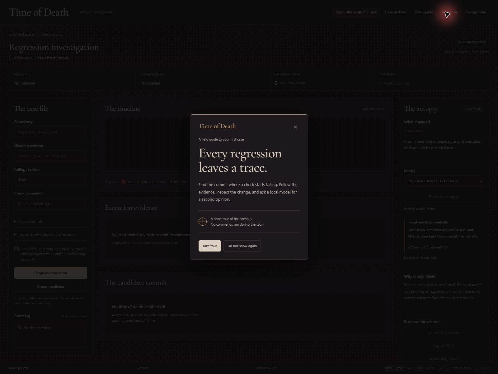
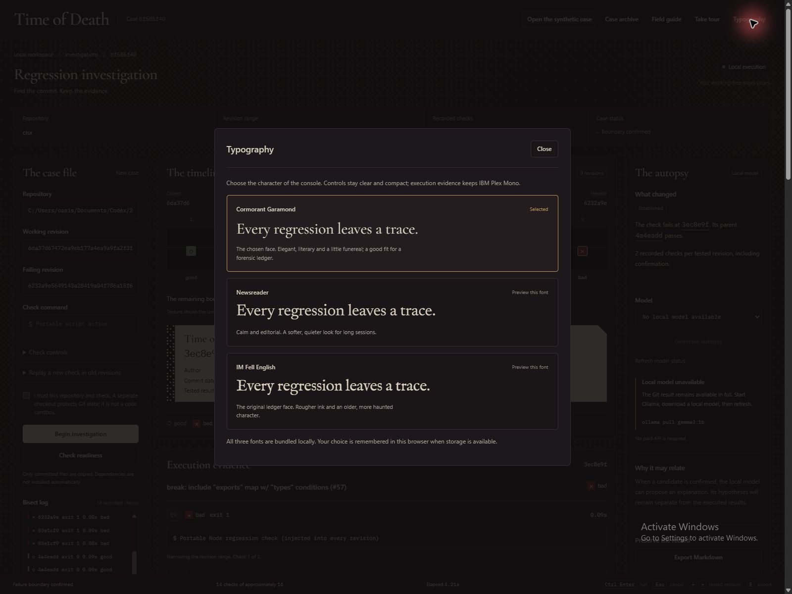

# Time of Death in screenshots

[Back to the project overview](../README.md). These captures show the current interface on October 31, 2026, in desktop Chrome at 1600 × 1200. They are original window captures.

The historical investigation was reopened from its saved case file. Its 4.212-second timing belongs to that recorded execution, not to taking the screenshots. The report export was exercised during capture. Local Ollama was unavailable, so these images do not claim fresh AI inference.

## Current workspace

Idle console with repository inputs, empty timeline, evidence panel and unavailable-local-model state.

## Tour welcome

The welcome card was reopened using Take tour in the header.

## Guided spotlight

Step 1 of 9 highlights the repository input while masking the surrounding page.

## Confirmed historical boundary

Saved case bf585f40: nine commits, fourteen receipts, candidate 3ec8e9f and passing parent 4a4eadd.

## Execution receipts and report export

Recorded package-path errors and a newly prepared bug-report download.

## Saved portable-check verification

The saved compatibility patch records parent good, culprit bad and proposed fix good; imported-helper limitations remain.

## Local font choices

Cormorant Garamond selected alongside Newsreader and IM Fell English previews.

The tour welcome, first spotlight, closing the tour, archive loading, report download and typography panel were exercised during capture. Complete keyboard, preference-persistence and narrow-screen acceptance testing remain separate work.
